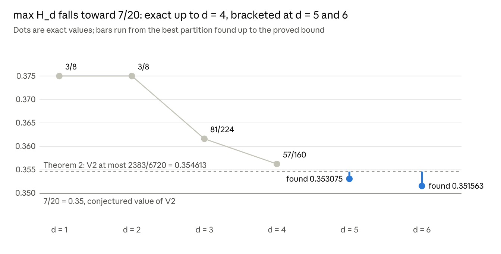

# Exact referee relaxations for Levine's two-player hat problem

Nov 4, 2026 · @Yang

## Abstract

We prove V₂ ≤ 2383/6720 ≈ 0.354613 for the two-player Levine hat problem, improving the previous bounds 81/224 ≈ 0.361607 and 3795217/10582656 ≈ 0.358626. The proof works with the common-row referee relaxations H\_d of \[W\], which satisfy V₂ ≤ max H\_d for every d.

First we solve the d = 4 relaxation exactly: max H₄ = 57/160 = 0.35625, attained by 11 symmetry classes (250,880 labelled partitions). Then a hierarchical search in dimension 5 caps each of the 31 hyperplanes using complete lists of near-optimal d = 4 partitions, and scores exactly the few complete partitions that survive. The bound closes 60% of the gap between 81/224 and the conjectured value 7/20.

Simulated annealing suggests max H₅ ≈ 1401/3968 ≈ 0.353075 and max H₆ ≥ 45/128 ≈ 0.351563, consistent with the relaxations converging to 7/20. All results are computer-assisted and not yet peer reviewed; the code, logs and independent checks accompany this note.

## 1. Introduction and results

Two players each wear an infinite stack of independent fair black or white hats. Each sees only the other's stack and points to one hat in their own; they win if both chosen hats are black. Let V₂ be the supremum of the winning probability over all strategies (equivalently, over finite stacks).

The best strategies win with probability 7/20, and Bouquet et al. conjecture V₂ = 7/20 \[BCCZW\]. Upper bounds have moved slowly. The trivial bound is 3/8; a computer-assisted argument of Freiling et al. gives 81/224 \[BFG+\]; a Fourier approach gives 0.37193 without large searches \[HT\]. Our earlier write-up \[W\] introduced a common-row referee and reached 3795217/10582656.

| Source | Upper bound on V₂ | Decimal |
| --- | --- | --- |
| Trivial | 3/8 | 0.375000 |
| Heilman–Tamuz \[HT\] | — | 0.371930 |
| Freiling et al. \[BFG+\] | 81/224 | 0.361607 |
| \[W\] | 3795217/10582656 | 0.358626 |
| Theorem 1 (this note) | 57/160 | 0.356250 |
| Theorem 2 (this note) | 2383/6720 | 0.354613 |

**Theorem 1.** max\_P H₄(P) = 57/160. Hence V₂ ≤ 57/160.

**Theorem 2.** max\_P H₅(P) ≤ 4766/13440 = 2383/6720. Hence V₂ ≤ 2383/6720 ≈ 0.354613.

Theorem 1 is the exact value of the d = 4 relaxation, so no argument based on H₄ alone can do better. Theorem 2 needs a genuinely five-dimensional search. Both are computer-assisted, and both rely on the referee reduction and the averaging inequalities of \[W\] (Section 2), which we checked by hand.

We also report evidence about the limits of the method (Section 7). The best d = 5 partition we found has H₅ = 1401/3968 ≈ 0.353075, and the best d = 6 partition we found has H₆ = 45/128 ≈ 0.351563. The relaxation values fall by roughly half each dimension, consistent with convergence to 7/20, but this is extrapolation.

## 2. The referee relaxation

Fix d ≥ 1. A label is a pair (a, b) with a ∈ F₂ᵈ∖{0} and b ∈ F₂; there are m\_d = 2(2ᵈ − 1) labels, and label (a, b) covers the point x ∈ F₂ᵈ when a·x ⊕ b = 1. Equivalently, labels are the affine hyperplanes of AG(d, 2) and a label covers its own points. For a partition P of the labels, keep each block independently with probability 1/2, let U be the union of kept blocks, and set

```latex
H_d(P) = \frac{1}{m_d}\, \mathbb{E} \max_{x \in \mathbb{F}_2^d} \#\{(a,b) \in U : a \cdot x \oplus b = 1\}.
```

**Lemma 1 (referee, \[W\]).** V₂ ≤ max\_P H\_d(P) for every d.

Sketch. Draw a hidden label J = (a, b) uniformly, independent uniform rows R\_i ∈ F₂ᵈ, and Bob's fair string Z. Alice's bits a·R\_i ⊕ b are independent and fair for each fixed J, so the game is unchanged. Reveal R to both players and J to Bob; extra information only helps. For fixed R, Bob's choice partitions the labels by the coordinate he selects, and the selected coordinates of Z keep blocks independently with probability 1/2. Alice then chooses a row, and allowing every x ∈ F₂ᵈ only helps her.

We write all d = 4 and d = 5 values in units of 1/13440, so 81/224 = 4860, 57/160 = 4788, 227/640 = 4767, 2383/6720 = 4766 and 7/20 = 4704.

**Lemma 2 (averaging, \[W\]).** For a three-dimensional subspace W of the coefficient space (a *frame*), let F\_W be the same objective restricted to the 14 labels with a ∈ W. Every label lies in the same number of frames, and every frame in the same number of hyperplanes T, so taking maxima separately can only increase the value:

```latex
H_d(P) \le \frac{1}{N_d} \sum_{W} F_W(P|_W), \qquad H_d(P) \le \frac{1}{2^d - 1} \sum_{T} H_{d-1}(P|_T),
```

where N\_d is the number of frames (15 for d = 4, 155 for d = 5). The restrictions keep the fair independent block law because distinct blocks stay distinct.

**Lemma 3 (symmetry).** H\_d is invariant under G\_d = AGL(d, 2) × ⟨σ⟩, acting on labels by (a, b) ↦ (Ma, b ⊕ a·c ⊕ s). Linear maps and translations relabel the points; the complement swap σ: b ↦ b ⊕ 1 preserves H\_d because each point is covered by exactly half the labels and U has the same law as its complement, so E max count(σU) = m\_d/2 − E min count(U) = E max count(U). G\_d has order 2 · 2ᵈ · |GL(d, 2)|: 2,688 for d = 3, 645,120 for d = 4.

## 3. Frames and the d = 3 local table

The frame objective is the d = 3 relaxation, and its maximum is 324/896 = 81/224. We scored all Bell(14) = 190,899,322 partitions of the 14 frame labels exactly, in 42 s on two cores. Each score is an integer N = 2¹⁴ · E max (so F = N / (14 · 2¹⁴)), computed by a Gray-code walk over all subsets of blocks.

| Frame score (×1/896) | Partitions | Orbits under G₃ |
| --- | --- | --- |
| 324 | 3,920 | 5 |
| 322 | 16,128 | 8 |
| 321 | 1,344 | 1 |
| 320 | 159,712 | 79 |
| 319 | 75,264 | 31 |
| 318 | 545,104 | 223 |
| 317.75 | 2,256 | 5 |
| 317.5 | 11,648 | 6 |
| 317 | 564,928 | 227 |

The first five counts agree with \[W\]. No score lies strictly between the listed levels, and every one of the 1,380,304 listed partitions keeps its score under all 2,688 elements of G₃.

For a partition P of the d = 4 labels, write R(P) = Σ\_W (324 − 896 F\_W) for its *frame loss* (exact, not rounded). Since 15 · 896 = 13440, Lemma 2 becomes the frame bound

```latex
H_4(P) \le \frac{4860 - R(P)}{13440}.
```

Alongside the full table we store, for every prefix of a restricted-growth string, the largest score over all completions. A frame whose first j labels are placed is then bounded by one table lookup. One lemma lets a single table serve every frame in every dimension.

**Lemma 4 (sorted affine subspaces).** List an affine subspace of F₂ⁿ in increasing numerical order as o₁ < o₂ < … . Then o\_{r+1} = o₁ ⊕ Σ\_k r\_k b\_k, where r\_k are the binary digits of r and b\_k is the reduced row-echelon basis ordered by leading bit.

Proof. Take o₁ reduced against the basis. Two elements differ first at the highest pivot where their basis combinations differ, so numerical order is the binary order of the combinations, and o₁ is the minimum. ∎

Consequently, if the labels outside a fixed subspace are placed in increasing order of a, any frame or hyperplane receives them in an order that a linear isomorphism carries to the canonical order.

## 4. Exact solution of the d = 4 relaxation

The maximum of H₄ is 57/160, reached by 11 orbits of partitions. We find it by branch-and-bound against a threshold L: we show every partition satisfies H₄ ≤ max(T\_L, best exact leaf), where T\_L = (4860 − L)/13440.

**Search.** Every partition has a frame of maximal score. By Lemma 3 we may move it to the frame of labels 0–13 (direction 8) and make its restriction an orbit representative R. All other frames then score at most N\_R, so if 15 times R's loss is at least L the frame bound already gives H₄ ≤ T\_L. Only representatives of smaller loss are searched, and the program checks this list against the full histogram.

The 16 remaining labels are placed in increasing order as a restricted-growth string. By Lemma 4, each of the other 14 frames sees its 6 shared labels first and its 8 new labels in canonical order, so the prefix table bounds it, clamped at N\_R. A node is pruned when the 15 frame bounds sum to at most 256(4860 − L). Surviving complete partitions are scored exactly over all 2ᴷ block subsets.

**Symmetry.** The 16 elements of G₄ that fix every frame label act regularly on the 16 outside labels and fix the root's blocks. So we may require label 14 to join the lowest-numbered root block used by any outside label. We also apply a lex-leader test, to depth 8, under every lift of R's stabilizer in G₃. Both reductions keep at least one representative of every orbit (Section 6).

| L | Root orbits | Nodes | Surviving leaves | Best leaf (×1/13440) | Time, 2 cores |
| --- | --- | --- | --- | --- | --- |
| 40 | 13 | 1.80 × 10⁷ | 6,728 | 4788 | 0.4 s |
| 56 | 14 | 3.44 × 10⁸ | 530,680 | 4788 | 8 s |
| 72 | 93 | 6.79 × 10⁹ | 16,671,664 | 4788 | 156 s |
| 80 | 124 | 3.30 × 10¹⁰ | 89,969,576 | 4788 | 12 min |
| 88 | 124 | 2.76 × 10¹⁰ | 93,598,369 | 4788 | 21 min |
| 96 | 352 | 6.20 × 10¹⁰ | 120,574,288 | 4788 | 23 min |
| 104 | 358 | 3.85 × 10¹¹ | 875,667,299 | 4788 | 1.9 h |

Runs from L = 88 use the kernel reduction, and from L = 96 the lex-leader test too, so leaf counts are of representatives.

**Proof of Theorem 1.** At L = 72 the threshold T₇₂ equals 4788/13440 = 57/160 and no leaf exceeds it. Hence max H₄ ≤ 57/160, and the leaves attaining it give equality. ∎

The optima form 11 orbits, 250,880 labelled partitions. Every optimum has 12 frames at 324/896, frame loss 36 or 40, and 5 or 6 blocks. One optimum with 5 blocks, writing a as a 4-bit vector:

- {(0001,0), (0010,0), (0100,0), (0111,0), (1001,0), (1010,0), (1100,0), (1111,0)}
- {(0001,1), (0010,1), (0101,0), (0110,0), (1000,1), (1001,1), (1010,1), (1011,0), (1101,0), (1110,0)}
- {(0011,0), (1011,1)}
- {(0011,1), (1000,0)}
- {(0100,1), (0101,1), (0110,1), (0111,1), (1100,1), (1101,1), (1110,1), (1111,1)}

**Near-optimal partitions.** The L = 104 run lists every partition with H₄ > 4760/13440. They take only nine values:

| H₄ (×1/13440) | H₄ | Orbits | Labelled partitions |
| --- | --- | --- | --- |
| 4788 | 57/160 | 11 | 250,880 |
| 4781 | 683/1920 | 48 | 1,320,480 |
| 4774 | 341/960 | 57 | 2,856,000 |
| 4770.5 | 1363/3840 | 15 | 1,854,720 |
| 4768.75 | 545/1536 | 13 | 2,419,200 |
| 4767.875 | 5449/15360 | 11 | 685,440 |
| 4767 | 227/640 | 69 | 8,534,400 |
| 4765.25 | 2723/7680 | 34 | 2,499,840 |
| 4763.5 | 1361/3840 | 33 | 3,427,200 |

In total 291 orbits and 23,848,160 labelled partitions. The values 341/960 and 1363/3840 also appear in \[W\] as maxima of its A₀ = 11 and A₀ = 10 families.

**Envelope.** The same runs give g(r), the largest H₄ among partitions with frame loss at least r. It falls fast once frame loss passes 40: g = 4788 up to r = 40, 4781 at 42, 4774 for 44–48, 4763.5 at 50, 4760 for 52–78, 4746 at 80–82, 4739 at 84 and 4732 for 86–103. Beyond the enumerated range only the frame bound 4860 − r applies, so after L = 104 the usable floor is 4756 for r ≥ 80.

## 5. A hierarchical search in dimension 5

Theorem 2 comes from a search over partitions of the 62 labels of F₂⁵ that bounds H₅ by the hyperplane average of Lemma 2, H₅ ≤ (1/31) Σ\_T H₄(P|\_T). The point is that each hyperplane is a copy of the d = 4 problem we have just solved, so its value can be capped long before it is complete.

**Root.** For a target τ, every partition has a hyperplane of maximal H₄. If that maximum is at most τ, the average is at most τ. Otherwise, by Lemma 3 in dimension 5, we move it to T₁₆ (the labels with a < 16, which are exactly the d = 4 labels) and make its restriction an orbit representative. So the roots are the d = 4 orbits with H₄ > τ, listed completely by Section 4 whenever T\_L < τ. Every other hyperplane then has H₄ at most the root value h₀.

**Caps.** The 32 outside labels are placed in increasing order. Each non-root hyperplane shares one frame (14 labels) with T₁₆ and gains 16 outside labels; its other 14 frames each have 6 shared and 8 new labels. A hyperplane's value is bounded by the minimum of:

1. the root value h₀;
2. its frame bound, from the prefix table of Section 3 for each of its frames;
3. the envelope g(r), with r the frame loss already forced by those prefixes;
4. a **level cap**. By Lemma 4 a linear isomorphism sends the hyperplane to the d = 4 labels with its outside labels at positions 14–29 in placement order. Its partial assignment is then a prefix of a restricted-growth string. A binary search in the sorted list of all 23.8 million labelled partitions above the floor, plus a range-minimum query, gives the best level any of them reaches from this prefix. If none extends it, the cap is the floor itself;
5. its exact H₄ once all 30 of its labels are placed.

A node is pruned when h₀ plus the 30 caps is at most 31τ, or when a completed hyperplane beats h₀ (that partition belongs to another root). Complete partitions that survive are scored exactly.

**Symmetry.** 32 elements of G₅ fix every root label and act regularly on the outside labels, so label 30 may be required to have minimal type as in Section 4. A lex-leader test to depth 12 then uses every lift of the root's stabilizer, between 512 and 18,432 elements per root.

**Proof of Theorem 2.** The run at τ = 4766 uses the L = 104 lists (floor 4760) and the 224 orbits with H₄ ≥ 4767; no d = 4 value lies strictly between 4765.25 and 4767. It split into 19,821 tasks run in 133 resumable chunks and visited 3.12 × 10¹⁰ nodes in 9.9 hours of computing. In the first 750 tasks, whose roots lie nearest the best known partition, 2,237 complete partitions survived the caps. Each was scored exactly, and the largest is 1401/3968 ≈ 0.353075, the best value known. Hence max H₅ ≤ 4766/13440 = 2383/6720. ∎

| Target τ (×1/13440) | Bound | Roots | d = 4 data | Nodes | Time |
| --- | --- | --- | --- | --- | --- |
| 4787 | 0.356176 | 11 | frame bounds only | 1.91 × 10⁹ | 208 s |
| 4781 | 0.355729 | 11 | L = 80 lists | 2.15 × 10⁸ | 220 s |
| 4777 | 0.355432 | 59 | L = 88 lists | 1.10 × 10⁸ | 294 s |
| 4774 | 0.355208 | 59 | L = 96 lists | 2.09 × 10⁸ | 289 s |
| 4771 | 0.354985 | 131 | L = 96 lists | 3.46 × 10⁹ | 54 min |
| 4769 | 0.354836 | 131 | L = 104 lists | 7.94 × 10⁹ | 114 min |
| 4767 | 0.354688 | 155 | L = 104 lists | 1.78 × 10¹⁰ | 5.2 h (40 chunks) |
| 4766 | 0.354613 | 224 | L = 104 lists | 3.12 × 10¹⁰ | 9.9 h (133 chunks) |

Down to τ = 4767 no run produced a surviving partition; at τ = 4766 the 2,237 survivors were all scored exactly. The floor drives the cost: with the L = 88 lists the target 4774 had covered 7% of its tasks after 13 minutes, while with the L = 96 lists it finished in under 5. Each background job here was limited to 2 hours, so the τ = 4767 and τ = 4766 runs were split into chunks (smaller ones where tasks were slow) and resumed across many jobs and machine restarts; every chunk log records identical settings.

Profiling at τ = 4777 shows where the work is. Most nodes sit between labels 39 and 43, and the largest single cut comes at label 45, when the first non-root hyperplane completes: 1.3 million nodes enter, about 1,800 survive.

## 6. Verification

Every program was written from the definitions alone, and each search was checked against independent code or a slower variant. The table lists what was tested.

| What | Check | Result |
| --- | --- | --- |
| Local table | 300 partitions rescored by direct subset summation in Python with exact fractions | 0 mismatches |
| Local table | Level counts against \[W\] | identical for all five levels |
| Symmetry, d = 3 | All 2,688 elements of G₃ on all 1,380,304 partitions scoring ≥ 317/896 | score always preserved |
| Witness of \[W\] | Frame scores, average and frame loss | 10 × 324, 1 × 320, 4 × 318; 151/420; 28 (exact H₄ = 45/128) |
| d = 4 bookkeeping | Incremental frame indices against direct recomputation, all 530,680 leaves at L = 56 | 0 mismatches |
| d = 4 completeness | Partitions of small frame loss found by an unrelated Python hill-climb, mapped into canonical form by an explicit element of G₄ | 15/15 found (root 324, L = 56); 8/8 found (root 322, L = 72) |
| d = 4 symmetry reductions | Envelope at every exact frame-loss value, and orbits of optimal leaves, with and without reductions at L = 72 | identical; 11 orbits each time |
| d = 4 exact scores | 400 best leaves and all 832 optimal leaves rescored in Python | 0 mismatches |
| Frame averaging | Lemma 2 on 60 random partitions | 0 violations |
| Orbit lists | Distinct images against stabilizer-based orbit size, all 291 orbits | equal |
| Hyperplane maps, d = 5 | H₄ of each hyperplane through its d = 4 map against direct evaluation, random partitions | 0 mismatches |
| Symmetry, d = 5 | Lifted root stabilizers on 1,000 random completions | H₅ and root partition preserved |
| d = 5 caps | 70 full partitions (random, hill-climbed, and lifts with up to 16 hyperplanes ≥ 4781) replayed through the search: every cap ≥ that hyperplane's final H₄, total ≥ 31 · H₅, at every depth | 0 violations in 2,310 node checks |
| d = 5 variants | Range-minimum and nested-list versions at τ = 4780; kernel-only and lex-leader versions at τ = 4777 | identical node counts at 4780; no survivors in either at 4777 |
| Chunked runs | Every task covered exactly once; every survivor scored exactly, none above τ | complete for L = 96, L = 104, τ = 4769, τ = 4767 and τ = 4766 |
| Survivors at τ = 4766 | Each chunk's best survivor rescored independently in numpy with exact integers; every survivor's exact H₅ checked against its own capped hyperplane average | 0 mismatches (best 1401/3968); 0 failures over 2,237 survivors |

Two inputs are not verified by code. The referee reduction (Lemma 1) and the averaging inequalities (Lemma 2) are taken from \[W\]; we checked their proofs by hand. All code ran on one machine, and nobody else has reviewed it.

## 7. Limits of the method and outlook

The method of Section 5 is close to its own ceiling, while the relaxations themselves appear to keep falling toward 7/20.



*Figure 1.* Exact values: brute force (d = 1, 2), Section 3 (d = 3), Theorem 1 (d = 4). Lower ends at d = 5, 6: simulated annealing. Upper ends: Theorem 2, using max H6 ≤ max H5.

Simulated annealing with exact scoring finds the d = 4 optimum on its first restart. At d = 5 the best of 11,360 restarts over 20 minutes is 1401/3968 ≈ 0.353075, found immediately and never beaten. At d = 6 the best of 6,493 restarts is 45/128 ≈ 0.351563. The drops between dimensions (0.0134, 0.0054, 0.0032, then at least 0.0015) roughly halve each time, consistent with a limit of 7/20, though this is extrapolation.

**The averaging ceiling.** The best d = 5 partition has hyperplane values 8 × 4788, 20 × 4781, 1 × 4606 and 2 × 4588.5, averaging 4764.74, about 19 units above its true H₅ of 4745.32. So the hyperplane average that every bound in Section 5 rests on has its maximum between 4764.74 and 4767. At τ = 4766 the search already scores a few thousand complete partitions exactly; below about 0.35452 it would have to score vast numbers, so Theorem 2 is within 10⁻⁴ of what this method can give.

**Coupled relaxations.** The averaging loss comes from letting each hyperplane choose its own row. Since every label lies in 15 hyperplanes, H₅ can also be bounded by averaging over pairs or triples of hyperplanes that must share a row: each such group is weighted so the counts sum to 15 · c(x), and maxima are taken group by group. On the best d = 5 partition these bounds tighten quickly:

| Bound on H₅ for the best partition | Value (×1/13440) |
| --- | --- |
| Hyperplanes, each with its own row (Lemma 2) | 4764.74 |
| Pairs of hyperplanes sharing a row (465 pairs) | 4756.79 |
| Triples sharing a row (4,495 triples) | 4749.51 |
| True H₅ | 4745.32 |

A search built on triples could in principle approach the true d = 5 value. The difficulty is timing: a group can be scored exactly only once all its hyperplanes are complete, which happens in the last eight or so outside labels, while most of the search cost lies earlier.

**Open directions.**

1. A d = 5 bound that does not let each hyperplane choose its own row would aim at the true value, about 0.3531.
2. Dimension 6 by the same hierarchy needs complete lists of near-optimal d = 5 partitions, beyond brute force.
3. Does max H\_d converge to V₂? If so, and V₂ = 7/20, the referee family is a route to the conjecture.
4. On the lower side, no strategy is known to beat 7/20, and no finite stack attains it \[BCCZW\].

## 8. Reproducibility

All computations ran on one 2-core x86-64 machine with 8 GB of memory, in about 28 hours of wall-clock time in total. The code is C++20 with SSE4.1, plus Python 3 for the independent checks; it is in this repository with its README and every run log.

| Program | Role |
| --- | --- |
| local3 | Scores all Bell(14) frame partitions; writes the full table (764 MB) and prefix maxima |
| rootclass | Orbits of frame patterns under G₃; checks score invariance |
| bb4, bb4s, bb4x, bb4y | d = 4 branch-and-bound: plain, kernel symmetry, lex-leader, streamed leaves |
| orbit4, expand4 | Orbit representatives under G₄; all labelled images, sorted |
| bb5, bb5L, bb5S, bb5R | d = 5 search: frame caps, level caps, lex-leader, range-minimum level caps |
| run\_chunks.sh, run\_d5.sh | Resumable chunked runs |
| merge\_chunks.py, check\_d5.py | Coverage checks over chunks; any survivor must be scored exactly at or below τ |
| pyref.py, verify.py, completeness.py, spotcheck\_local.py | Independent Python checks (Section 6) |
| anneal, anneal6 | Simulated annealing for max H\_d, d = 4, 5, 6 |

To reproduce Theorem 2: build the frame table, run the d = 4 search at L = 104 in chunks, reduce and expand the orbits above 4760, then run the d = 5 search at τ = 4766 with those lists and the 224 roots above 4766 and check the chunks. The README lists the exact commands.

## References

- **\[BCCZW\]** C. Bouquet, S. Chikhi, T. Charles, Y. Zhou, E. Wang. [An analytical framework for the Levine hats problem: new strategies, bounds and generalizations](https://arxiv.org/abs/2508.01737). arXiv:2508.01737, 2025.
- **\[BFG+\]** [On Levine's notorious hat puzzle](https://arxiv.org/abs/1407.4711), arXiv:1407.4711; an earlier version is J. Kariv, C. Van Alten, D. Yeroshkin, *Computing optimal strategies for a cooperative hat game*. Cited as \[BFG+22\] in \[HT\] for the bounds 7/20 and 81/224, the latter credited to Freiling et al.
- **\[HT\]** S. Heilman, O. Tamuz. [A Fourier approach to Levine's hat puzzle](https://arxiv.org/abs/2503.09042). arXiv:2503.09042, 2025.
- **\[W\]** A compact computer-assisted improvement for Levine's two-player game. Write-up by the author of this note, 2 November 2026. Included with the code as [paper/write-up-2026-11-02.md](write-up-2026-11-02.md).
